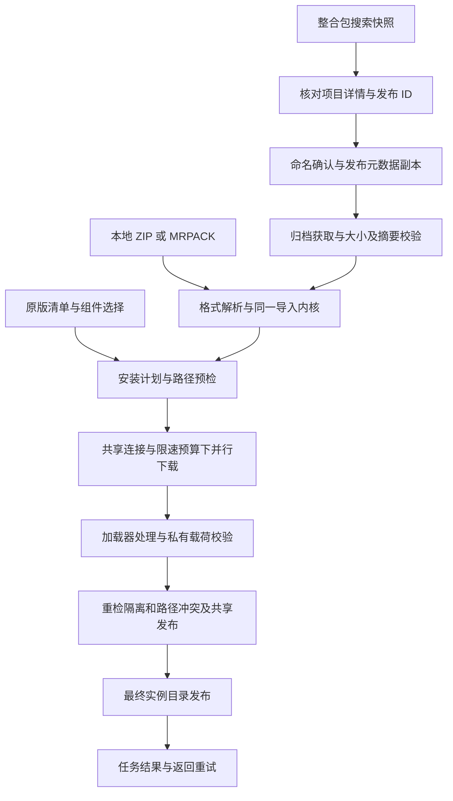

# PCL-DB 全仓综合审查报告

审查日期：2026-10-22（北京时间）。代码基线：`main @ f8601e41807e0b1e03cbeaefb6965ea49205555a`。

本报告将本次请求中的“PCLDE”按当前仓库 **PCL-DB / Plain Craft Launcher - Download Bridge** 理解；不涉及再次改名。

## 1. 总体结论

**当前项目已经具备完整的下载补全和整合包安装链路，适合继续在现有架构上修整。下一阶段应优先修复正确性和验证入口，再量化动画与下载性能。**

- 下载核心已具备自动选源、共享连接/速度预算、动态分段、续传、校验、缓存和跨阶段并行；本地导入与在线搜索安装进入同一安装内核。
- 搜索已经覆盖“搜索 → 选择项目 → 选择版本 → 命名 → 下载归档 → 安装”。详情、分页、返回、取消重试与动画有专门状态管理，不再只是入口演示。
- 动画已经有分层时钟所有权、冻结退出画面、重入接续和隐藏/卸载清理。本轮没有确认新的动画主干故障，但仍有加载节奏差异，**没有实际桌面帧率或与 PCL 同条件的流畅度对比证据**。
- 本轮确认了无摘要共享运行库错误复用、CurseForge 非正式版本身份丢失、分页上限不一致、历史包校验器误拒等缺陷；另确认搜索专用检查没有进入所有候选打包/VS 验证入口。详见第 5 节。
- 普通构建及现有全套回归通过，**不能据此宣布没有 Bug、所有历史加载器兼容或当前源码已经具备新的发行候选**。现有 Beta 包与当前源码相隔多个提交。

本轮仅新增审查报告及隔离取证文件，未修复业务源码、修改测试项目、Commit、推送、制作候选、打包或发布，也未操作用户已有游戏实例。

## 2. 范围、基线与证据规则

### 2.1 仓库和发行状态

| 项目 | 本轮核实结果 |
| --- | --- |
| 仓库 | `D:\CodeProjects\Minecraft\PCL-DB` |
| 分支 / 完整提交 | `main` / `f8601e41807e0b1e03cbeaefb6965ea49205555a` |
| 初始工作区 | 干净，无已暂存或未暂存业务改动 |
| 本地跟踪状态 | 比本地 `origin/main` 跟踪引用超前 35 个提交；未查询 GitHub 当前分支，不将其当作远端实时状态 |
| 本地发行标签 | `v1.0.0-beta.1` → `a60f904cf78ca3eeb2bc82b45fa2a6e31cefd443`；HEAD 描述为 `v1.0.0-beta.1-35-gf8601e4` |
| 当前版本显示 | 仍为 `1.0.0-beta.1` / `Beta 1.0`；“复制版本信息”另含完整构建标识，不能说完全无法区分构建 |
| 既有发行工件 | `dist` 中 Beta 1.0 清单的 `SourceCommit` 为 `c1fe25040c4d72497b9eade6ed354fe06bb6bc97`；不是本轮 HEAD 的候选 |
| 技术栈 | VB.NET、WPF、.NET Framework 4.8，App / Core / Tests 三个工程，命名空间及程序集为 `PclDownloadBridge` |
| 本机开发环境 | VS Community 2026 18.10.3、ManagedDesktop/net48 targeting、.NET SDK 10.0.401；本轮未在 IDE 内人工 F5/断点验收 |

清点了 313 个受跟踪文件：App 142、Core 40、Tests 59、tools 11、reference 46，其余为根文档和工程文件。App 数量包括检查代码和资源，不能解读成 142 个业务模块。

覆盖方法为全仓清点、重点路径语义审查、固定上游源码对照、全套本地回归、独立定向复现、当前只读联网元数据查询及历史工件核对。**没有声称对每个文件每行进行了形式验证，也不是一次专门的全面安全审计。**

### 2.2 PCL 对照方式

主参照为本地 `D:\CodeProjects\Minecraft\PCL` 中固定提交：

```text
5ef81e490ae46b1100d61e33d0183094c7a80ca8
```

使用 `git show <固定提交>:<路径>` 读取，而非把本地 PCL 当前 HEAD 当作未限制版。重点对照：

| 领域 | 固定 PCL 参照 |
| --- | --- |
| 页面和侧栏 | `FormMain.xaml.vb`、`PageDownloadLeft.xaml.vb`、`MyPageRight.vb` |
| 曲线、滚动、控件 | `ModAnimation.vb`、MyCard/MyScrollViewer/MyListItem 等控件 |
| 自动选源与下载调度 | `ModDownload.vb`、`ModDownloadLib.vb`、`ModNet.vb` |
| 搜索和详情 | `PageResource.xaml.vb`、`ResourceSearcher.vb`、`ResourceVersion.vb`、`PageDownloadCompDetail.xaml.vb` |
| 版本识别与隔离 | `PCLCS/Minecraft/McVersion.cs`、`ModMinecraft.vb`、INI 读取规则 |
| 整合包 | `ModModpack.vb` 的 CurseForge / Modrinth 安装流程 |
| 外观、关于 | 个性化、关于页面布局与原图标、字体、头像等资源 |

固定资源/源码比对 17 项通过，其中包含 44 份源快照哈希核对。这能证明被比较的资源和参数符合固定来源，不能证明整个应用与 PCL 逐像素、逐帧等价。

### 2.3 证据等级

本报告区分：**本轮本地自动化、独立复现、本轮真实联网元数据、历史安装记录、静态机制确认、待测风险**。历史安装通过不充当本轮重装通过；离屏采样不充当桌面帧率；安装成功不充当游戏启动成功。

本轮统一证据目录：`D:\CodeProjects\Minecraft\PCL-DB\artifacts\audit-20261022-f8601e4`。该目录被 Git 忽略；本报告记录关键结果，使结论不依赖只在本机保存的附件。

## 3. 当前功能与产品边界

### 3.1 已接通的主要能力

| 功能 | 当前源码现状 | 限制 / 交付状态 |
| --- | --- | --- |
| PCL 游戏目录 | 发现 PCL 使用的 `.minecraft`、自定义游戏目录与当前选择；可手动选择 | 目标是让安装结果供 PCL 使用，不注册插件、不修改上游启动器 |
| 原版版本清单 | 正式版、快照、远古版、愚人节等分类，长列表按可见区域延迟创建行 | 清单状态和组件查询有独立代次，刷新失败不应串入旧选择 |
| 补充版本 | 战斗测试版及限定实验快照，处理 ID 别名、来源、分类、索引冲突 | 当前范围为 12 个战斗测试、7 个 1.18 实验快照、1 个 1.19 深暗实验快照；不是任意第三方版本；补充源失败不阻断普通清单 |
| 下载源 | 版本信息和文件各自选择自动 / 官方优先 / BMCLAPI 优先 | 社区搜索使用独立平台通道，BMCLAPI 不是整合包搜索 API；偏好是优先级，不是禁止其他来源 |
| 原版及组件安装 | Forge、NeoForge、Fabric、Fabric API、OptiFine、OptiFabric、LiteLoader；包含安装器/处理器和配置合并 | 并非所有组合都允许；有兼容与互斥限制，未证明全历史官方安装器均可用 |
| 实例隔离 | 跟随 PCL / 开启 / 关闭三态；读取既有实例与 PCL 全局规则；旧资源按实际运行目录规划 | 已有实例设置优先并保持原字节，不因新默认值迁移；libs/assets 共享，不等于 Mods 必须共享 |
| 已有实例补全 | 对明确选择的同版本原版实例校验、补文件 | 不支持把任意加载器实例或已改写配置当普通原版修复；不覆盖原 JSON/隔离设置 |
| CurseForge ZIP | 解析固定 projectID/fileID、客户端文件与 overrides，查询文件信息和校验依据 | 新隔离实例；不能静默替换/跳过缺失必需文件；目前 BetterMC 原包仍有外部必需文件不可取得的历史证据 |
| Modrinth MRPACK | 精确依赖、客户端 required/optional/unsupported、双哈希、多个地址、overrides/client-overrides | 单一 Forge/NeoForge/Fabric 或原版；Quilt、未知必需依赖及多个加载器不能自动跳过 |
| 整合包搜索 | 名称、MC 版本、类型、CurseForge/Modrinth 来源；独立分页；项目 → 具体版本 → 命名 → 下载安装 | 两个平台同名项目保留独立身份；源失败提示部分结果；本轮无 API key 的 CF 搜索不可用，MR 可用 |
| 下载与任务页面 | 归档、元数据、游戏/资源/组件、处理器、发布等阶段；速度/连接/复用/诊断；取消与返回重试 | 内容传输字节不含所有 HTTP/TLS 开销；阶段成功不能替代实际启动验收 |
| 外观和关于 | PCL 字体/图标/控件风格、蓝色与深色、独立关于页、第三方说明、来源/赞助/文档链接 | 额外色彩主题经开发者会话校验后在个性化显示；验证码不是安全边界或上游授权证明 |
| VS 与交付 | VS 2026 工程/多调试配置；显式制作单 EXE 候选，再发布 ZIP、清单及目录 | 单 EXE 内嵌应用依赖，不内嵌 .NET Framework / Java；本轮没有制作当前候选 |

当前 README 已明确将整合包搜索/导入、三态隔离等标为 **当前源码后续功能**，不能说这些均已包含在历史 Beta 1.0 分发包中。

### 3.2 主链路及所有权



页面动画负责呈现和输入归属；请求对象/代次决定异步结果是否仍有效；任务取消源控制下载与处理器退出。这几种所有权已经分开，应继续保持。后续调整动效时不应重新触发安装、替换所选文件身份，或让旧回调复活隐藏页面。

## 4. 专项审查结果

### 4.1 动画、视觉、输入与关于页

本轮未确认新的动画主干 Bug。已有保护包括：

- `PclSurfaceMotion` 对主页面、下载分类、搜索及详情内容分别持有时钟；完成回调检查自身是否仍为当前所有者。
- 冻结退出图像、互斥分段蒙版与固定视口裁剪；快照限制为四百万像素、最多 16 个可见内容单元分段，另有剩余画面及可选滚动条分段，总层数最多 18，避免为长列表全部行创建退出动画。
- 主页面进入采用上游的 Y=-16、100ms 淡入、250ms Fluent 与 350ms Back 并行位移；卡片、箭头、按压、选择与滚轮各有相应接续机制。
- 反向切页、刷新、隐藏、卸载、尺寸改变会收束旧时钟，恢复 transform / opacity；隐藏结果更新不会直接播放当前设置页的子动画。
- 关于页返回保留设置滚动位置；焦点恢复检查新的用户焦点，避免完成后强行把滚动位置拉回旧按钮。

主要证据位置：[PclSurfaceMotion](D:/CodeProjects/Minecraft/PCL-DB/src/PclDownloadBridge.App/Controls/PclSurfaceMotion.vb:55)、[PclExitSnapshot](D:/CodeProjects/Minecraft/PCL-DB/src/PclDownloadBridge.App/Controls/PclExitSnapshot.vb:26)、[滚轮](D:/CodeProjects/Minecraft/PCL-DB/src/PclDownloadBridge.App/Controls/PclScrollViewer.vb:27)、[搜索动效联动](D:/CodeProjects/Minecraft/PCL-DB/src/PclDownloadBridge.App/MainWindow.ModpackMotion.vb:8)、[关于返回与焦点](D:/CodeProjects/Minecraft/PCL-DB/src/PclDownloadBridge.App/MainWindow.About.vb:20)。

隔离隐藏 WPF 探针实际打开下拉、捕获滑块 Thumb 后触发页面门控：下拉自动关闭、子项不可命中、鼠标捕获撤销。**这两个候选已排除，不要求为“缺少本地事件处理”另加修复。**程序主动执行 `EditingCommands.Delete` 可修改不可命中的 TextBox，只能说明程序命令与输入命中不同；未证明普通用户可通过上下文菜单绕过门控，不计 Bug。

仍有以下明确差异及测量缺口：

| 编号 | 现状 | 建议 |
| --- | --- | --- |
| A-01 / 体验改进 | 固定 PCL `MyPageRight` 有 400ms LoaderWait，加载控件入场后有 400ms LoaderStayForce；当前搜索/详情立即替换为加载卡，快响应也经过加载/结果两次呈现更新 | 统一加载呈现状态：短响应直接进入内容，慢响应显示 loader；等待回调必须受请求和可见性约束。最短展示时长不应阻塞网络任务或实例发布 |
| A-02 / 还原细节 | 主导航 110+30ms 与上游一致，但下载侧栏上游为 130+30ms，本仓仍复用 110+30ms | 参数化主导航、侧栏、内容刷新时序；同步输入门控及焦点时点，避免只移动视觉延迟 |
| A-03 / 偏好策略 | 系统动画关闭时页面和滚轮走即时模式，部分按钮/卡片/选择动效仍会运行 | 若要提供统一“减少动态效果”，建立一致策略，并检查关闭动画后的终态；目前不作为违反现有承诺的 Bug |
| A-04 / 性能待测 | UI 线程有同步 RenderTargetBitmap、UpdateLayout、懒行视口检查和图标解码；虽有限制，尚无冷/热布局与高 DPI 的 P95/最大阻塞数据 | 先测快照耗时、UI 阻塞和帧间隔，再决定预解码、共用视口观察器或减少快照；不能凭源码路径直接宣布已经掉帧 |

参考源代码并不等于“肉眼无法区别”已经验收。仍需同窗口/缩放/主题/系统动画设置下，与固定 PCL 录制相同交互轨迹并进行真实桌面观察。

### 4.2 下载、选源、并行与恢复

已确认的机制和边界：

| 机制 | 本轮判断 |
| --- | --- |
| 清单自动选源 | 官方/BMCL 竞速带延迟备源、解析验证和失败提前激活；不是收到任意 HTTP 200 就接受。会话中的官方清单响应速度影响自动文件源顺序 |
| 跨阶段并行 | 客户端/基础库、资源、整合包文件分支并行；组件安装等待必要客户端/基础库，不等待全部资源。失败取消同伴并等待退出 |
| 连接和速度预算 | 分支共享全局连接、主机门限及限速；BMCL 有请求间隔约束。不能给每个分支各开一份用户连接上限 |
| 分段与续传 | 严格检查 Range/长度，恢复未完成段、按最大剩余段拆分，Range 不可靠时回退普通下载；取消保留可校验缓存 |
| 文件声明与缓存 | 同目标合并校验要求，冲突预检；支持 SHA-512/SHA-1/MD5/严格受限 S3 校验。缓存命中仍复核内容 |
| 本轮确认例外 | 无摘要组件运行库的共享发布使用弱 Matches 判断，可能复用同长度坏文件；见 F-01 |

入口证据：[SourcePolicy](D:/CodeProjects/Minecraft/PCL-DB/src/PclDownloadBridge.Core/SourcePolicy.vb:94)、[跨阶段编排](D:/CodeProjects/Minecraft/PCL-DB/src/PclDownloadBridge.Core/MinecraftInstaller.vb:143)、[连接预算](D:/CodeProjects/Minecraft/PCL-DB/src/PclDownloadBridge.Core/DownloadBudget.vb)、[动态分段](D:/CodeProjects/Minecraft/PCL-DB/src/PclDownloadBridge.Core/PclSegmentScheduler.vb:91)、[下载引擎](D:/CodeProjects/Minecraft/PCL-DB/src/PclDownloadBridge.Core/DownloadEngine.vb:218)。

“高速”目前有算法和正确性证据，缺少与 PCL 相同网络、内容、冷热缓存和连接数下的吞吐、尾延迟比较。普通哈希、复制和分段合并中的若干同步操作没有分块取消；外围 token 检查能防止取消后发布，但慢盘大文件时等待取消多久尚未量化。两者是后续测量任务，不计作已经复现的性能故障。

### 4.3 搜索、选择、详情与安装联动

已有正向能力：

- 查询复制为快照，编辑框的未提交内容不会改变已接受查询和详情目标；同一在途搜索不重复发送，短时无错误结果可复用。
- 每源独立原始偏移、每页 40 条展示，过滤页最多补查四轮；结果不足但来源未结束时保留“继续加载”。源结束/失败时保留最后有内容的页面。
- 项目身份为平台+ID；详情元数据经过核对，搜索项目对象不被原地覆盖；旧项目迟到结果不能覆盖新详情。
- 版本按游戏版本分组，卡片延迟创建并缓存；重名按文件名、版本、ID 逐步区分，实际安装继续使用冻结的原始身份。
- 目录标签只用于兼容筛查，依赖来自包内清单；只有支持的必需加载器才能进入自动安装。归档校验后复核所选版本与包清单。
- 在线归档下载、命名、可选项、任务完成/失败与返回重试连接到了已有安装内核。

本轮新增确认问题为 F-02、F-03。独立源并发请求目前会等所有活跃源完成再提交批次；单个来源慢时可能延后已有快速结果。这与固定 PCL 等待搜索线程的做法接近，**不列为未对齐 Bug**。未来如做渐进呈现，需要另外定义结果稳定排序和页边界，不能只在界面提前插入数据。

本轮真实联网只读查询时间为北京时间 **22:16**：

| 通道 | 结果 | 能证明什么 |
| --- | --- | --- |
| Modrinth | 搜索到 `l9m9tuPN`；详情取得 7 个可安装发布，包含 `6OMYdNAO` 的 2.3 和 `M8j2mfGj` 的 2.3 Fix | 当前本机网络的搜索、项目与版本元数据链路可用 |
| CurseForge 网页搜索 | 403 Forbidden | 当前该渠道查询失败；不是整个 CurseForge 平台永久失效的结论 |
| MCIM 搜索备用源 | 503 Service Temporarily Unavailable | 当前该备用渠道不可用；不能把它当唯一可靠来源 |
| 自有 CurseForge key | 本机未配置 | 未验证有 key 的官方搜索，不把无 key 失败归为凭证实现 Bug |
| 合并搜索 | 保留 1 个 Modrinth 结果，带 CF 部分失败信息 | 部分降级逻辑实际生效；本轮未下载归档、安装或启动游戏 |

CurseForge 的**搜索接口**与其**精确文件信息查询接口**并不相同：搜索失败不意味着所有已有 ZIP 都不能导入；具体缺失文件也不能因搜索成功而被略过。

### 4.4 安装、隔离、路径冲突与原子发布

当前机制较完整，未发现需要另建安装内核的理由：

- 每游戏根目录有跨进程安装互斥；新实例先写私有 stage，完成校验后同卷 `Directory.Move` 发布。
- 既有实例补全核对原 JSON、客户端/索引及运行声明；涉及旧资源映射时同时核对隔离输入，提交前重检并短期锁定；不初始化、迁移已有设置。普通现代原版补全不额外读取隔离配置。
- 共享 Mods / 旧资源有拓扑冲突检查、发布期保护及失败回收；只回收本次新增且内容仍符合本次预期的文件，不回收用户原文件或其后修改的文件。
- 整合包固定新隔离实例，归档锁和 SHA-256 绑定避免选择后换包；覆盖层有明确顺序、生成路径保护及发布再验证；包内设置不能把隔离关闭。
- 已校验的共享 libraries/assets 可以在最终实例发布前写入并保留供复用。**实例目录原子发布不等于整个 `.minecraft` 的断电安全事务**；已有实例补全也不是全部修复文件一起回滚。

关键证据：[隔离读取](D:/CodeProjects/Minecraft/PCL-DB/src/PclDownloadBridge.Core/PclIsolationPlan.vb:26)、[共享 Mods 发布](D:/CodeProjects/Minecraft/PCL-DB/src/PclDownloadBridge.Core/SharedModsPublication.vb:9)、[旧资源发布](D:/CodeProjects/Minecraft/PCL-DB/src/PclDownloadBridge.Core/LegacyResourcePublication.vb:25)、[包计划](D:/CodeProjects/Minecraft/PCL-DB/src/PclDownloadBridge.Core/ModpackInstallPlan.vb:35)、[归档到安装](D:/CodeProjects/Minecraft/PCL-DB/src/PclDownloadBridge.Core/ModpackArchive.vb:95)。

两份实包的证据边界必须保留：

| 实包 | 已存在的历史证据，本轮只读核对 | 尚不能声称 |
| --- | --- | --- |
| BetterMC 1.20.1-v1.5 | 86 项中 85 个可用载荷完成查询/下载/校验；必需 `227639/5071019` 当时为空/404，原 ZIP 在游戏目标目录创建前拒绝安装 | 该原包已经完整安装，或 Forge 47.2.0 / 游戏启动已验收。不能为“通过测试”换掉必需文件 ID |
| Zombie Invade 100 Days 2.3 | MRPACK 历史实装记录：MC 1.20.1 + Forge 47.4.10；129 个外部文件双哈希、1176 个覆盖文件逐项比对；发布前取消后重试，游戏/包载荷传输为 0 | 本轮重新执行了完整实装，或游戏已启动。独立在线搜索安装记录与本地包记录也不是同一份归档身份 |

历史证据来自 [VALIDATION](D:/CodeProjects/Minecraft/PCL-DB/VALIDATION.md:88) 及相应实包回执；当前审查未再传输这些完整载荷。

### 4.5 构建、VS、打包及发行

打包架构是“先制作并验证不可变单 EXE 候选，再将精确候选发布到分发输出”。候选绑定源码、文件摘要、依赖、嵌入文档和验收回执，优于直接把最新 bin 目录压缩。异常时四个分发输出有备份/替换回滚，但强杀/断电自动恢复尚无本轮证明。

本轮只读检查旧 Beta ZIP 的 **8 个载荷、9 个 ZIP 条目**，长度/SHA-256、内部/独立清单、目录和独立 EXE 相互一致。旧 EXE 为 `NotSigned`，文档也没有将摘要清单冒充数字签名。此结论只说明历史资产自洽，不是对其来源的认证或当前代码打包验收。

确认问题为历史包校验器 F-04、搜索候选门禁 G-01 和文档漂移 F-05。下次发行还必须确定新的版本身份，避免把当前新增功能装入仍叫 beta.1 的资产中，与既有 Beta 混淆；本轮不更改版本。

许可材料方面，只核对本地 `LICENCE`、署名、第三方说明及随包包含情况。该文件同时含外链许可和自称非法律文件的使用指南；本轮没有独立核查外链全部条文或作出合法性判断。额外主题藏于开发者入口不等于获得额外授权。此项作为后续对外发行前的既有边界记录，不重新展开名称解释，也不把它编造成运行时 Bug。

### 4.6 设置保存、旧名兼容与开发者入口

本轮未确认这些常规路径存在新的功能 Bug：

- [DownloadSettingsFile](D:/CodeProjects/Minecraft/PCL-DB/src/PclDownloadBridge.App/DownloadSettingsFile.vb:31) 优先读取新设置；旧设置迁移先解析、保留原字节，以同目录唯一临时文件原子发布。`SaveChanges` 在路径级跨进程 Mutex 内差量深合并，保留未知字段，减少不同窗口互相覆盖旧快照的机会。
- 保存失败不会推进外观/开发者设置的已保存 baseline；读取失败暂停自动保存，只由明确保存操作尝试恢复，避免关闭窗口时把坏文件悄悄覆盖成默认值。
- 外观输入有类型、数值范围与非有限数处理；未解锁时回退公开主题。解锁状态每次启动重新锁定，不把会话授权持久化为普通偏好。
- 关于页副作用入口有外链/文档约束与失败反馈。此次没有重新发现旧的滚动位置/焦点问题。
- 源码/工程身份为 `PclDownloadBridge`。`VanillaDownloader`、`PlainCraftDownloader` 留作旧偏好目录兼容键；测试中的 PCD 描述用于验证迁移，不是残留程序集或命名空间冲突。不能为清除旧词而删除迁移代码。

尚有未确认测试边界：启动时先求值旧目录发现参数，再调用读取新设置；如果旧目录的属性查询因访问权限异常而失败，是否会不必要地阻断有效新设置。本轮独立权限夹具未得到安全可靠的复现，只记为后续异常路径验证点，不计入 F 类缺陷，也没有改动真实用户设置。

## 5. 问题清单与修复建议

优先级：P1 为明显影响常用主流程或数据的高优先问题；P2 为有条件的正确性问题或交付门禁缺口；P3 为低频边界、细节或文档问题。**本轮未确认 P0/P1，不代表已证明不存在。**

| 编号 | 优先级 | 状态 | 问题 |
| --- | --- | --- | --- |
| F-01 | P2 | 独立复现 | 无摘要组件运行库可能复用同长度坏共享库并报告安装成功 |
| F-02 | P2 | 独立复现 | CF 非正式游戏版本 ID 被丢弃，分组/筛选及目录到清单的 MC 核对退化 |
| F-03 | P3 | 独立复现 + UI 错误分支静态确认 | 分页最大值与 HasNext 不一致，超过上限后展示进入错误状态 |
| F-04 | P2 | 历史工件只读复现 | 当前校验器因测试数量变化拒绝内容自洽的旧 Beta v2 包 |
| F-05 | P3 | 静态确认 | VS 文档当前计数/配置说明和项目预览措辞漂移 |
| G-01 | P2 | 代码路径确认的验收缺口 | pack-search 专用套件未进入单 EXE 候选、清单与 VS 验证链路 |

以下问题尚未在本轮修复，报告中的建议不应解读成已实现。

### F-01：无摘要共享运行库错误复用

**位置**：[ComponentInstaller.vb:128](D:/CodeProjects/Minecraft/PCL-DB/src/PclDownloadBridge.Core/ComponentInstaller.vb:128)，弱匹配语义见 [Models.vb:121](D:/CodeProjects/Minecraft/PCL-DB/src/PclDownloadBridge.Core/Models.vb:121)。

触发为合法形状的旧 Forge 配置：最终运行库只声明 size、不提供摘要；已验证安装器中的私有库为 `correct`，共享 `libraries` 同路径已有等长 `corrupt`。发布循环用 `SafeFiles.Matches(destination, libraryInfo)` 仅凭长度跳过，随后成功发布新实例。

独立夹具结果：`instancePublished=true`、`actualRuntime=corrupt`；只为相同库增加正确 SHA-1 的对照则得到 `actualRuntime=correct`。使用回环 HTTP 和自有临时安装器，不需要改变产品代码或真实游戏目录。未枚举官方配置中此类库的实际比例，不能扩大为所有 Forge/NeoForge 都受影响。

影响是安装成功提示与实际可用内容不一致，之后可能无法在 PCL 中启动；换新实例名重装也未必消除坏共享库。

建议在组件发布边界，为来自已校验安装器或已校验处理器输出的私有运行库固定本地摘要，再用其判定目标内容是否一致。该摘要表示“与本次正确输出一致”，不能冒称上游声明摘要，也不能把任意无来源保证的 hashless 下载算一次本地摘要就当作权威。已有无摘要目标内容不同，应明确报冲突并保护原文件；缺失目标原子创建，提交阶段保留竞争重检/租约。不要全局改变 `SafeFiles.Matches` 而误伤合法 hashless 下载路径。

验收：同长坏库明确拒绝且不发布实例；同内容复用；缺失库正确创建；有上游摘要的修复路径保持；并发替换/取消/只读目标不覆盖他人文件；各官方代表性安装器回归通过。

### F-02：CurseForge 游戏版本身份丢失

**位置**：[ModpackCatalog.vb:195](D:/CodeProjects/Minecraft/PCL-DB/src/PclDownloadBridge.Core/ModpackCatalog.vb:195)、[ModpackCompatibility.vb:17](D:/CodeProjects/Minecraft/PCL-DB/src/PclDownloadBridge.Core/ModpackCompatibility.vb:17)、[分组入口](D:/CodeProjects/Minecraft/PCL-DB/src/PclDownloadBridge.App/MainWindow.ModpackVersions.vb:19)。

CF 将 `gameVersions` 中混合的游戏版本、加载器标签拆开时，只保留数字正式版和 `24w14a` 形式。有效非正式 ID 被静默删除：

| 输入，均有 Forge 标签及其他有效文件字段 | 解析后的 GameVersions | 将包清单 MC 错置为 1.20.2 的核对结果 |
| --- | --- | --- |
| `1.20.1` / `24w14a`（对照） | 保留 | 正确拒绝 |
| `1.21-pre1` / `1.21-rc1` / `26.1-snapshot-1` / `b1.7.3` | 空数组 | 不再进行 MC 比对，接受该核对调用 |

这是本地目录解析/核对夹具，不代表已找到这些版本的某个线上 CF 整合包或完成其安装。后续包解析仍会严格检查依赖，不能称为绕过全部安装校验。

固定 PCL `ResourceVersion` 会使用 `McVersion.IsStandardFormat`，其对 `1.x` / `26.x` 有前缀识别；而本仓 MR 分支保留原始 `game_versions`。因此 CF 非正式版本丢失既影响“其他”分组和目标筛选，也令本来有版本声明的数据被误当成无声明。

建议统一游戏版本识别，保留精确原始 ID 供安装绑定；展示归类与身份分开，不把 PCL 的显示归一化结果直接拿来比较包清单。区分“平台没给版本”和“给了但解析不认识”，未知值不应静默降成空声明；保留加载器标签拆分规则。

验收：正式版、pre/rc、周快照、新命名快照、远古版逐项覆盖；CF/MR 对等数据保留同一精确目标；错 MC 清单拒绝、正确清单接受；普通加载器/Java 标签不误作游戏版本。

### F-03：分页上限不一致

**位置**：[HasNext:47](D:/CodeProjects/Minecraft/PCL-DB/src/PclDownloadBridge.Core/ModpackSearchSession.vb:47)、[GetPageAsync:63](D:/CodeProjects/Minecraft/PCL-DB/src/PclDownloadBridge.Core/ModpackSearchSession.vb:63)、[下一页:151](D:/CodeProjects/Minecraft/PCL-DB/src/PclDownloadBridge.App/MainWindow.ModpackSearch.vb:151)、[错误呈现:215](D:/CodeProjects/Minecraft/PCL-DB/src/PclDownloadBridge.App/MainWindow.ModpackSearch.vb:215)。

用离线 API 返回 50,000 个唯一项目，依次正常取第 0–500 页：共缓存 20,040 项、发出 501 个请求。此时 `HasMore=true`、`HasNext(500)=true`，但取第 501 页立即抛 `ArgumentOutOfRangeException`。UI 据 HasNext 保持按钮可用，下一次调用会清空当前呈现并隐藏分页显示失败。核心未删除已缓存数据，不能描述成永久数据丢失。

触达需很深分页，故列 P3。修复应统一页数策略：保留上限时禁用下一页并给出缩小查询提示，且保持当前结果；若改变上限，应同步会话、界面与资源使用约束，不能单删校验。

验收：上限前一页、上限页、非法下一页和回退；单源/双源、缓存结果多于页容量、来源提前结束、过滤空页及取消仍保持原行为。

### F-04：历史包校验器误拒

**位置**：[PackageTools.psm1:35](D:/CodeProjects/Minecraft/PCL-DB/tools/PackageTools.psm1:35)，README 推荐入口见 [README.md:240](D:/CodeProjects/Minecraft/PCL-DB/README.md:240)。

当前 `Assert-BuildManifest` 对同为 `PCL-DB-single-exe/v2` 的清单强制 UI=754、Motion=358。历史 Beta 清单合法记录当时的 658/328，执行当前只读 `Test-PclDbPackage` 会先报 `Invalid build manifest.`，尚未进入载荷核对。

独立逐项核对旧 ZIP、目录、独立 EXE、内部/外部清单均一致；仅在内存副本改两个数字后通过清单断言，进一步确认原因。历史工件未改写，不能把拒绝解释为旧包损坏。

建议分离“归档 schema、结构、哈希完整性”和“绑定本次源码的候选验收策略”。归档检查识别当时有效的 suite/计数；当前候选继续要求准确源码、套件身份和门槛。为新清单增加套件标识时须保留旧 v2 的明确兼容策略。

验收：旧自洽归档通过；坏载荷、重复/异常路径、缺失/零值验证字段仍拒绝；拿旧候选冒充当前候选仍拒绝。不要改写旧发布包来适配新工具。

### F-05：当前文档漂移

[VS2026_DEBUG.md:42](D:/CodeProjects/Minecraft/PCL-DB/VS2026_DEBUG.md:42) 仍写核心 1859 项，本轮实跑为 2051；第 108 行“九个短回归”与当前默认 32 个控制台配置、8 个 App 配置不符；`THIRD_PARTY_NOTICES.md:5` 仍称“本地预览项目”，与已存在的 Beta 发行状态不一致。

建议将当前验证入口与计数集中维护，区分默认、Full 和独立搜索套件；修正当前说明而保留历史记录原数值。不要批量替换整个 VALIDATION 中的旧计数。

### G-01：搜索套件未进入完整交付验证链路

**位置**：[verify-single-exe.ps1:65](D:/CodeProjects/Minecraft/PCL-DB/tools/verify-single-exe.ps1:65)、[PackageCandidateTools.psm1:79](D:/CodeProjects/Minecraft/PCL-DB/tools/PackageCandidateTools.psm1:79)、[PackageTools.psm1:155](D:/CodeProjects/Minecraft/PCL-DB/tools/PackageTools.psm1:155)、`launchSettings.json`、`verify-vs2026.ps1`。

普通 `build.ps1` 已运行 `--pack-search-checks`，本轮 147 项通过。但是单 EXE 验证只执行 standalone/all/motion，candidate result 与清单只记录这三组；VS 配置和验证入口也未接入该 scope。`-SkipTests -Package` 或单独走候选验证时，可在未执行搜索专用检查的条件下满足现有候选门槛。

这属于**已确认的验证覆盖缺口**，不是已经证明分发 EXE 搜索失效。本轮没有为验证该入口而制作新候选。

建议在精确单 EXE 候选中运行并记录 PackSearchChecks，贯通 result → candidate parser → build-manifest → archive validator → VS 配置/脚本。scope、Succeeded、Count 与 Passed.Count 一并校验；系统动画关闭分支应按实际套件约定处理，不能盲目只接受 147。

验收：错误 scope、缺失搜索回执、失败/计数不符阻断当前候选；系统动画开启/关闭路径均符合约定；旧归档兼容性按 F-04 独立处理；普通构建和显式 SkipTests 打包路径最终都不能跳过候选搜索验收。

## 6. 本轮验证与尚未完成的验收

### 6.1 本轮实际执行

| 项目 | 结果 | 证据 |
| --- | --- | --- |
| `build.ps1`，未传 Package | Release 构建成功，0 警告、0 错误 | `full-validation.log` |
| Core 全量 | 2051 项通过 | 同一日志的 `ALL PASSED`；回环 HTTP / 自有临时目录 |
| UI / 动作 | scope `all`，754 项；Succeeded=true，Passed.Count=754 | `ui-checks.json` |
| 动画 | scope `motion`，358 项；Succeeded=true，Passed.Count=358 | `motion-checks.json` |
| 搜索页面/流程 | scope `pack-search`，147 项；Succeeded=true，Passed.Count=147 | `pack-search-checks.json` |
| 固定 PCL 对齐 | 17 项通过，包含 44 份固定源快照哈希 | `full-validation.log` 前段 |
| 组件无摘要坏库 | Bug 复现；有 SHA-1 对照正常 | `download-install/unhashed-runtime-result.json`、`hashed-runtime-control-result.json` |
| 搜索边界 | CF 身份丢失及深分页边界复现；普通版本对照正常 | `search/search-boundaries-result.json` |
| 隐藏页 Popup/Thumb | 实际 WPF 探针退出 0，两项候选排除 | `animation/input-boundary-results.txt`、`input-boundary-probe.md` |
| 当前搜索服务 | MR 可用；CF 网页403 / MCIM503；仅元数据 | `search/live-metadata-result.json` |
| 历史包 | 独立哈希/结构一致；当前验证器误拒复现 | `packaging/historical-assets-evidence.json`、`historical-verifier-probe.json` |

上述各套件覆盖有交叉，**不相加成一个“独立场景总数”**。统一摘要为 `validation-summary.json`，初始 Git 状态为 `baseline.json`。

### 6.2 仍欠缺的证据

| 优先级 | 未验证范围 | 需要补什么 |
| --- | --- | --- |
| P2 | 原生桌面动画流畅度与还原度 | 100%/150%/200% DPI，810×470/普通/大窗口，蓝/深色，冷/热页，下载中切页；记录 UI 阻塞、帧间隔 P95/最大值，不能只报告录屏编码 FPS |
| P2 | 下载性能与取消延迟 | 官方快/慢、镜像回退、Range拒绝、断流、16/64连接、冷热缓存、不同大小文件；拆分网络、磁盘、哈希耗时及取消响应 |
| P2 | 真实组件矩阵 | Forge旧/新、NeoForge、Fabric、OptiFine及兼容组合；先覆盖 hashless 运行库、无 outputs 处理器及旧 install.path。夹具不能替代官方代表样本 |
| P2 | 游戏和 PCL 实际启动 | 用指定已验证实例在 PCL 列表中发现并启动；区分文件验证、JVM参数检查、游戏启动、账号验收 |
| P2 | 磁盘不足与超大包 | 估算归档/分片/缓存/工作树/覆盖载荷的峰值；ENOSPC、权限变化、失败回收与可重试性，不能把 ZIP 上限当完整磁盘预算 |
| P2 | 当前单 EXE 候选及冷环境 | 用户以后明确要求打包后，绑定本次确切 result.json；无 SDK/VS 环境、缺 net48/Java、普通用户权限等实测 |
| P3 | 真实编辑命令/弹出菜单边界 | 程序主动执行命令的诊断不足以证明用户可达；如继续核查应在隔离 UI 中走真实菜单路径 |
| P3 | 强杀/断电恢复 | 新实例/共享文件/打包输出的 kill-point 恢复测试；目前的异常回滚不等于断电恢复 |

## 7. 下一步方案与验收顺序

建议按小批次推进，不把正确性修复、动效重构和发行版本变更混为一次大提交。

### 第一批：修正内容与版本身份

目标：修 F-01、F-02，防止“显示安装成功却使用坏共享库”和所选游戏版本核对退化。

范围：组件最终发布、游戏版本标识解析、目录到清单兼容性；先加入能在当前基线上失败的正式回归，再最小修复。

验收：本报告两套复现由失败变为明确拒绝或正确内容；有摘要库/正式版/周快照/原目录无声明行为保留；保留用户共享库、隔离设置及已有实例；并发、取消、重试和原子发布回归通过。不要引入第二套下载器或修改全局匹配函数语义来掩盖局部问题。

### 第二批：统一分页与交付验证入口

目标：修 F-03、F-04、F-05、G-01。

范围：分页上限策略、历史归档校验与当前候选门槛分离、搜索 scope 全链路、当前 VS 文档。先确定新 manifest 字段/兼容策略，再同步各脚本，避免只改生成端导致验证端冲突。

验收：深页不跳错误页；旧 Beta 自洽归档恢复可核对；坏包和旧候选冒充当前仍拒绝；搜索回执无法绕过；普通构建通过。此批可用解析器和受控回执测试验证，不必因改了打包脚本就立刻制作新发行包。

### 第三批：动画加载节奏与实测

目标：解决 A-01 并建立流畅度证据，随后处理 A-02/A-03。

先记录相同操作轨迹基线，再接统一 loader 等待状态；覆盖 0/50/399/401ms 返回、入场途中完成、隐藏、取消、请求替换、缓存翻页与失败重试。保留当前 root/category/content 时钟所有权，不让延迟状态修改安装任务。

验收：快响应不额外展示无意义加载阶段；慢响应节奏稳定；旧回调不能复活页面或抢焦点；跨 DPI、窗口大小及下载负载的帧耗时无回退，并与固定 PCL 的同轨迹观感对比。若未测出瓶颈，不先重写布局或快照架构。

### 第四批：下载与真实安装可靠性

目标：测出吞吐、取消和磁盘瓶颈，并补官方代表性安装样本。

先对同步哈希/复制/合并测取消 P95，再决定统一分块 token-aware helper；调整时保留临时文件→校验→原子提交顺序。性能比较固定内容、源、缓存、连接及限速；不能用暖缓存复用安装与冷缓存下载比较“提速”。

BetterMC 必需文件仍不可取得时应继续明确失败，不能换 ID 作为修复。Modrinth 使用本地包与在线选定发布分别验收；完成文件校验后，另安排真正的 PCL/游戏启动检查。

### 发行前的独立关卡

只有用户再次明确要求打包/发版时才执行。先确定新版本及发布说明，再从最终干净源码生成新单 EXE 候选，运行包含搜索的新门禁，使用**该候选精确 result.json 路径**校验四项分发输出及摘要。旧 Beta 工件不得充当当前候选；保留历史工件，不覆盖其版本身份。

## 8. 取证索引与保留范围

综合报告本身：[PCL-DB-full-review-2026-10-22.md](D:/CodeProjects/Minecraft/PCL-DB/docs/reviews/PCL-DB-full-review-2026-10-22.md)。

| 材料 | 绝对位置 |
| --- | --- |
| 基线与本轮完整检查 | `D:\CodeProjects\Minecraft\PCL-DB\artifacts\audit-20261022-f8601e4\baseline.json`、`validation-summary.json`、`full-validation.log` |
| 动画详细审查与隐藏 WPF 探针 | `D:\CodeProjects\Minecraft\PCL-DB\artifacts\audit-20261022-f8601e4\animation\animation-review.md`、`InputBoundaryProbe.cs`、`input-boundary-probe.md`、`input-boundary-results.txt` |
| 下载/安装详细审查与复现 | `D:\CodeProjects\Minecraft\PCL-DB\artifacts\audit-20261022-f8601e4\download-install\download-install-review.md`、`reproduce-unhashed-runtime.ps1`、两份 runtime result JSON |
| 搜索复现与实时查询 | `D:\CodeProjects\Minecraft\PCL-DB\artifacts\audit-20261022-f8601e4\search\reproduce-search-boundaries.ps1`、`SearchBoundaryHandler.cs`、`search-boundaries-result.json`、`live-metadata-result.json` |
| 打包详细审查 | `D:\CodeProjects\Minecraft\PCL-DB\artifacts\audit-20261022-f8601e4\packaging\packaging-review.md`、`historical-assets-evidence.json`、`historical-verifier-probe.json` |
| 历史实包记录 | `D:\CodeProjects\Minecraft\PCL-DB\VALIDATION.md`；Modrinth 逐文件回执在 `artifacts\modrinth-polish\live\report.json` 等目录，本轮未重装 |

取证文件仅位于忽略的 artifacts 和审查报告目录。现有源码、测试、用户整合包、游戏目录、其他启动器仓库、发行资产和 Git 提交均未由本轮审查改写。本文结论针对所列提交与本机条件；后续修复后应按新提交更新结论和回执，不覆盖本轮失败证据。
